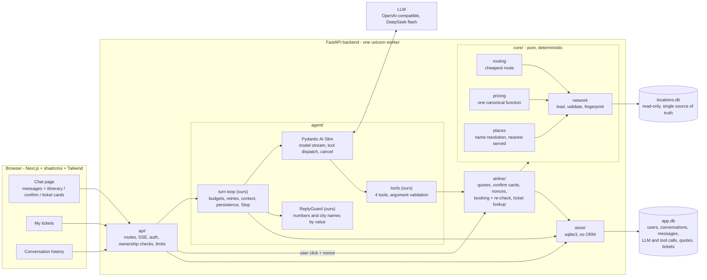
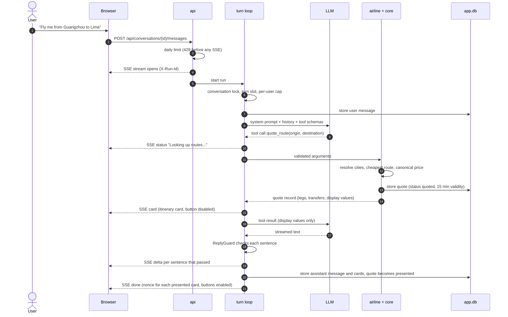
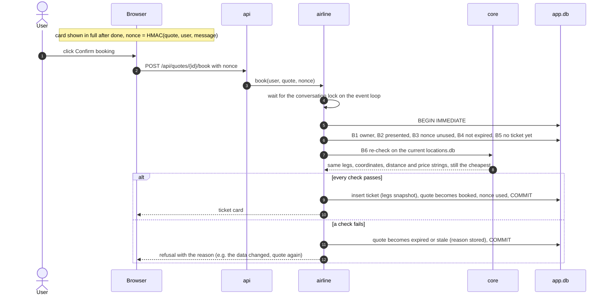

# Ocean Above — design doc

## TL;DR

Demo: https://ocean-above.potafree.net (Google or invite-code login). The five take-home questions in one line each:

- **Architecture and data flow (§1):** Next.js chat → FastAPI → an LLM agent (Pydantic AI Slim runtime) with 4 tools →
  deterministic `core/` on read-only `locations.db`; app.db (SQLite) stores users, chats, quotes and tickets.
- **Tools (§2):** `find_city`, `quote_route`, `request_booking`, `list_my_tickets`. Inputs are names and ids, never
  numbers. There is **no `book` tool**.
- **Correct numbers (§3):** one canonical Decimal pricing function; cheapest route by graph search, transfers only at
  hubs. Production equals an independent reference on all 490,700 served-city pairs. ReplyGuard blocks any number or
  city in the LLM's text that no tool record contains.
- **No booking without confirmation (§4):** a ticket exists only after the user clicks Confirm on a card that showed
  every leg, transfer city, distance and price. The click carries a one-time nonce the LLM never sees. Rules B1–B7 are
  model-tested; Stop never makes a card bookable.
- **Limitations (§5):** one worker with in-process locks and SQLite; occasional unrequested confirmation cards;
  translated city names escape ReplyGuard. Context compaction is character-based and best-effort (§5.5). Each has a next step.
- **Key numbers:** 0 safety violations in every real-model run. Multi-model benchmark (N=3, 45 cases, §7.3):
  DeepSeek flash passes 96.3% (official API) and 98.5% (Bailian); Qwen3.8-flash 91.1%, about 2× the reasoning tokens.
  1,005 backend tests.

Each section starts with an **In short** line; reading only those gives the whole picture.

## Key numbers and where to check them

| What | Value | Source |
|---|---|---|
| Backend tests | 1,005 (pytest + hypothesis, incl. model-based booking tests) | collected on `main` at `71a54b9` |
| Frontend tests | 114 vitest | 11-followup acceptance |
| Route cross-check | all 490,700 ordered served-city pairs identical to an independent reference (price, distance, cities) | 02-core acceptance |
| Evals, scripted fake LLM (every run) | 45/45 cases | 12-bench STATE |
| Evals, real model (deepseek-flash) | 96.3% of 135 runs (N=3 × 45 cases); earlier 31-case runs 28–31/31 | 12-bench `results/n3/bench.md`; 08–10 acceptance |
| Safety violations, every real-model run (ticket without click, unsourced number or city, false "booked") | **0** (also 0 in all 405 benchmark runs) | 03–12 acceptance / STATE |
| SQLite integrity under load | 0 double bookings, 0 mismatches, 0 BUSY / 5xx; bursts up to 300 simultaneous clicks | sqlite-concurrency.md §X.5 |

Every real-model failure so far is a trajectory deviation that cannot book (§5.4).

## Where the details live

| Document | What it holds |
|---|---|
| [docs/design/design.md](docs/design/design.md) | Chinese working notes, the full decision record ("notes §" below) |
| [docs/design/adr-001-agent-runtime.md](docs/design/adr-001-agent-runtime.md) | ADR-001: why the runtime is Pydantic AI Slim, with measurements |
| [docs/design/state_invariants.md](docs/design/state_invariants.md) | numbered rules: booking B1–B7, quotes Q1–Q3, quota U, concurrency C, Stop R1–R8 |
| [docs/design/sqlite-concurrency.md](docs/design/sqlite-concurrency.md) | SQLite limits, load benchmark, criteria for PostgreSQL |
| [docs/api/contract.md](docs/api/contract.md) | HTTP + SSE + card contract (v1.7) |
| [frontend/DESIGN.md](frontend/DESIGN.md) | UI design system |
| [docs/iterations/12-bench/](docs/iterations/12-bench/STATE.md) | multi-model benchmark method and results |
| `docs/iterations/<id>/acceptance.md` | what was accepted per iteration, on which commit, with which numbers |

Sections 1–5 follow the five required questions of `Quotr Agent Dev Engineer take-home.md`; §6 is how it was built and
tested; §7 is the optional "what would the real bot need". Numbers are measured values copied from the records above.

## 1. Architecture and data flow

*In short:* browser → FastAPI → agent loop (Pydantic AI Slim) → 4 tools → `airline/` → pure `core/` on `locations.db`; facts reach the user as cards rendered from records, text only after ReplyGuard.

### 1.1 Components

Deployment: `docker compose` with three services — `proxy` (Caddy, the only published port), `web` (Next.js) and
`api` (FastAPI, one worker) — plus an optional `phoenix` service for traces (§6.4). `locations.db` is mounted
read-only as a directory, so a replaced file is seen and reloaded (fingerprint change). `app.db` lives in `./data/`.
The demo runs the same compose file on a small VPS behind Cloudflare ([docs/deploy.md](docs/deploy.md)).

### 1.2 Module boundaries

| Module | Knows | Does not know |
|---|---|---|
| `core/` | `locations.db`, geometry, Decimal arithmetic | LLM, HTTP, app.db, users |
| `airline/` | `core/`, app.db through `store/`, booking rules B1–B7, ownership | LLM, HTTP |
| `agent/` | the LLM, the four tools, ReplyGuard, budgets, the run registry | `locations.db` and `core/` directly — only through tools → `airline/`; it has **no booking path** |
| `api/` | HTTP, SSE, cookies, login (dev account, invite codes, Google ID token), daily limits | routing, pricing |
| `frontend/` | the contract; renders cards from server records | it never formats or computes a number (every number comes from a `*_display` field) |

The airline side (cities, quotes, booking, ticket lookup) sits behind one service interface (`airline/`) so it could
become an MCP server or be replaced by a real booking system without touching the agent (§7).

**Runtime.** The generic agent loop — model streaming, chunk parsing, tool dispatch, run cancellation and
OpenTelemetry spans — is [Pydantic AI Slim](https://ai.pydantic.dev/) (`pydantic-ai-slim==2.71.0`, pinned). Everything
that decides safety or correctness stays our code: booking, ReplyGuard, history and context compaction, the SSE
contract, retries, budgets and concurrency limits ([ADR-001](docs/design/adr-001-agent-runtime.md), §7.1).

### 1.3 One chat turn (a quote)

If a sentence fails ReplyGuard, the loop sends `replace` with a reply built from a code template that uses only the
records, and stores the reason. Cards are rendered only from records, so even a wrong sentence never puts a wrong
number on a card.

SSE events (contract v1.7): `status`, `card`, `delta`, `replace`, `ping` (every 15 s), and exactly one terminal event:
`done`, `error` or `cancelled`. Closing the tab does not stop a turn: it runs to the end and is stored; the reply appears
on reload. Only the Stop button stops a turn (§4.4).

### 1.4 Booking click

A booking event is then added to the conversation, so the next chat turn (and the history view) knows about the
ticket.

### 1.5 Data model

app.db (SQLite, WAL) holds `users`, `conversations`, `messages` (with cards and a `completed` / `cancelled` status),
`llm_calls` (request, response, tokens, latency), `tool_calls`, `quotes`, `quote_cards` (which message presented a
quote, when, and whether its nonce was used) and `tickets` (`quote_id` UNIQUE). Distances and prices are stored as
high-precision decimal strings, never as display values. Nonces are not stored; they are recomputed as an HMAC (notes
§7). Every LLM request and response and every tool call is stored: this is what the history view, the evals' replay
and debugging read.

## 2. The agent's tools, and why

*In short:* four coarse tools that take names and ids and return records with display-ready values; no tool can book, and the loop adds budgets, retries and ReplyGuard.

### 2.1 The four tools

| Tool | Input | Output (a record) | Why it is shaped this way |
|---|---|---|---|
| `find_city` | `name` | canonical name, served or not, hub or not, connected hubs; if unserved: the 3 nearest served cities; if unknown or ambiguous: candidates | City lookup and "no service → nearest served city" (requirement 8) are deterministic. Ambiguous names (`San Jose` / `San José`) return `ambiguous_city` and the user chooses; the code never guesses. |
| `quote_route` | `origin`, `destination` | a **quote**: id, legs, transfer cities, per-leg and total distance, price (display values; the high-precision values stay server-side), validity; or a typed error: `unknown_city`, `ambiguous_city`, `same_city`, `no_service` (with the nearest served cities, excluding the other endpoint), `unreachable` | A quote is an immutable record. The itinerary card, the confirmation card, the booking re-check and the ticket all refer to the same id. |
| `request_booking` | `quote_id` | a confirmation card record: the full route, distance, price and validity of that quote. **Never a nonce.** | The only thing the LLM can do towards booking is make this card appear. The nonce is issued with the turn's `done` event, outside anything the model sees. |
| `list_my_tickets` | optional `city`, `ticket_id`, `booked_after`, `booked_before` | ticket records + `count` | Requirement 9. Tickets come only from app.db; the count is computed by code, not by the model. |

There is **no `book` tool** and no other path from the agent to the booking endpoint.

### 2.2 Design choices

- **Few, coarse tools.** Four tools cover all ten requirements. Fewer tools mean fewer wrong choices and a success
  rate that is easy to measure per tool (§6.2).
- **Inputs are names and ids, never numbers.** The model has no way to pass a distance or price it computed itself.
  User and conversation ids come from the run's trusted context, never from model arguments, so a tool cannot act
  for another user.
- **Outputs are display-ready.** The model receives formatted values (`$1,810.21`, `9,497.3 km`, `count: 3`), so it never
  needs to round or convert. High-precision values are removed from what it sees.
- **Errors are records too.** Unknown, ambiguous, unserved and unreachable each have a typed code and their own
  card. Even if the model words the answer badly, the card shows the right facts.
- **Validation is strict and structured.** Arguments are checked against the JSON schema in `agent/tools.py`
  (no extra fields, strings only); a bad call returns `invalid_arguments` to the model, which can correct itself,
  and is counted as a tool failure in the evals. Tools run sequentially, in call order.
- **Tool descriptions say what a tool does *not* do.** `request_booking`: "It does NOT book: the ticket is issued only
  when the user clicks Confirm booking on the card." The system prompt repeats it and tells the model to copy
  numbers only from tool results and to use the English city names from the records.

### 2.3 What the loop adds around the tools

- **Budgets per turn** (`agent/budget.py`, notes §4.8): at most 6 LLM steps, 4 tool calls per step, 12 per turn, 4,096
  output tokens per call, a 60,000-token soft cap per turn and 90 s per turn (all configurable; an invalid value
  stops the app at startup). Refused calls are not executed and get a structured `tool_budget_exceeded` result; a
  turn that runs out ends with a template reply. **A budget stop never books and never changes a quote.**
- **Concurrency** (notes §4.9, invariants C1–C4): one lock per conversation shared by chat turns and booking clicks;
  at most 8 turns site-wide and 2 per user; refused turns store nothing and give back the day's message slot.
- **Retries:** up to 2 per step, only while none of that step's text has been released to the client; every attempt
  is logged and charged.
- **Context:** every stored message plus earlier tool calls, as the compact JSON the model saw then. When the history
  grows past its budget, older turns are shortened and finally replaced by a system note that keeps their quote and
  ticket ids (`agent/context.py`). A nonce can never enter the context.

### 2.4 ReplyGuard: every number and city has a source

ReplyGuard (`agent/guard.py`, notes §4.5) checks the model's text **sentence by sentence before it is streamed**:

- **Numbers by value.** Every number in a sentence, after normalisation and with its unit (`$` ↔ price, `km` ↔
  distance; miles, hours and percentages are never allowed), must equal a display value in a record visible in
  this conversation, or appear verbatim in the user's message. Counts come only from code fields (`count`,
  `leg_count`, `transfer_count`). Ordered-list numbers are allowed only as 1, 2, 3 …; ids and dates are allowed.
- **City names by value.** Every city name from `locations.db` in a sentence must appear in a record or a user
  message of this conversation. This stops "the nearest airport is Dubai" from general knowledge — in this database
  the nearest served city to Abu Dhabi is Tirana.
- **Booking claims.** "Booked / confirmed / your ticket" wording is refused unless this turn contains a real booking
  event or a non-empty ticket lookup.
- **On failure** the whole reply is replaced (`replace` event) by a template that only uses records; sentences
  already streamed cannot be taken back, so the guard never edits text, it swaps it. The reason is stored and counted
  in the evals.

Measured on the real model: 50/50 turns passed unchanged and 0 fallbacks on the first 31-scenario run (notes §4.5);
1.5% fallback in the 03-slice evals (27 cases × 3). Known gaps are in §5.

## 3. Routes, distances, prices, and how the numbers stay correct

*In short:* one canonical high-precision pricing function, cheapest route with transfers only at hubs, checked against an independent implementation on every served pair; rounding only for display.

### 3.1 One source of truth

`locations.db` is opened **read-only** and validated at startup (malformed data stops the server instead of being
repaired). It is never copied: the API reads the file in place, keeps an immutable in-memory `Network` with a
content fingerprint (`sha256:…`), and reloads when the file changes. Every quote stores the fingerprint it was
computed on. Today's file: 711 cities, 40 hubs, 151 hub links, 10 non-hub cities without service.

### 3.2 Graph model

- Nodes are cities. Edges: one per `hub_links` row (hub ↔ hub) and one per entry of a non-hub city's
  `connected_hubs` (city ↔ hub). Every edge works in both directions.
- **Transfers only at hubs:** a non-hub city can only be the first or last city of a route.
- A non-hub city with empty `connected_hubs` has no service; it gets the `no_service` record with the nearest served
  cities.
- Leg distance = Euclidean distance between the two coordinates (km). Ticket distance = sum of legs. Price =
  distance × 0.13 USD.

### 3.3 Cheapest route

Price is proportional to distance, so the cheapest route is the shortest one. Because Euclidean distance satisfies
the triangle inequality, a direct flight, where one exists, is always the cheapest (requirement 5 follows).

Algorithm (`core/routing.py`, notes §5):

1. **When the network is loaded:** for every pair of hubs, networkx `shortest_simple_paths` (Yen) lists every simple
   path within a tiny tolerance of the best integer edge weight (weight = the canonical leg distance scaled to an
   integer at 1e-30, so the comparison has no float error). The tolerance can only add candidates: it keeps exact
   ties between irrational sums (e.g. √2 + √8 = √18) from being lost. Measured on the real file: exactly one candidate
   per hub pair, about 0.12 s to load.
2. **Per query:** combine every hub the origin connects to with every hub the destination connects to (or the city
   itself if it is a hub), price each candidate route with the canonical function, and take the minimum by
   (price, number of legs, city names) — a deterministic tie-break.
3. networkx only proposes candidates; **its path lengths are never used.** Every price comes from the canonical
   function.

Library choice: networkx (well known, stable) for candidate generation instead of a hand-written search; it is covered
by the reference tests below.

### 3.4 One canonical pricing function

`core/pricing.py: price_path(net, cities)` is the only place a distance or price is computed — for quotes, for the
booking re-check and in production-vs-reference comparisons:

- `decimal` with an explicit context on every call (precision 50, `ROUND_HALF_EVEN`); no Decimal operation in `app/`
  uses the thread's default context (a bug of exactly that kind was caught by the cross-check in 02-core and is now a
  review rule).
- Per leg `sqrt(dx² + dy²)`, summed in leg order, × `Decimal("0.13")`; distance and price stored as strings with 30
  decimal places. Legs whose length is not a perfect square are 50-digit approximations, so we call the values
  "high-precision", not "exact".
- The total is computed from the unrounded legs and quantised once, so "sum of stored legs" and "stored total" may
  differ by at most (number of legs) × 1e-30; the total is authoritative.
- **Rounding happens only for display** (`fmt_km`: 1 decimal; `fmt_usd`: cents, `ROUND_HALF_UP`) and a rounded value
  is never fed back into a calculation. The card's "How this price is calculated" section shows every leg at high
  precision, the sum and × 0.13, and notes that the displayed distance × 0.13 can differ from the displayed price by a
  cent because the price uses the unrounded distance.

### 3.5 How we know the numbers are right

| Layer | Check | Source |
|---|---|---|
| Algorithm | `backend/tests/reference.py` is a second implementation sharing no code with `app/` (own database reader, own graph, own Decimal arithmetic, per-pair Bellman-Ford). It is compared with production on **every ordered pair of served cities: 490,700 pairs**, identical price strings, distance strings and city sequences (27.6 s). | 02-core acceptance |
| Algorithm | Hypothesis-generated small graphs (disconnected parts, ties, collinear cities) against an exhaustive enumeration of all valid paths. | 02-core acceptance |
| Structure | Every intermediate city is a hub, every leg is a real flight, total = sum of legs, price = distance × 0.13. | `backend/tests/` |
| Determinism | A quote computed in a fresh thread with the default Decimal context is byte-identical to the main thread's. | notes §5 |
| Presentation | Cards are rendered only from records; the frontend never computes or formats numbers (contract). | contract v1.7 |
| Model text | ReplyGuard (§2.4) before streaming; the evals check again that every number and city in each reply has a source. | §6.2 |
| Booking time | B6 re-check on the current file before a ticket is written (§4.2). | invariants B6 |

Expected numbers in tests come from the reference implementation, never from an LLM.

### 3.6 Unknown, ambiguous and unserved cities

- Name resolution (`core/places.py`): exact match (NFC) first, then case- and accent-insensitive. If folding matches
  several cities (`San Jose` and `San José` is the one such pair in the file) the result is `ambiguous_city` with both,
  shown with their connected hubs; the code never picks. No match → close candidates (difflib).
- Nearest served city (requirement 8): the 3 nearest cities with at least one direct flight, by the same Euclidean
  distance; for a route, the other endpoint is excluded so the suggestion is never the city the user is flying to.
  The evals pick cases where the database answer differs from geographic intuition (Abu Dhabi, Stuttgart, Austin).

## 4. Nothing is booked without the user's confirmation

*In short:* only a user click with a one-time nonce on a fully shown card books; the LLM can only make the card appear; B1–B7 are enforced in one transaction and model-tested.

### 4.1 The mechanism

1. A quote reaches status `presented` only when its full card — every leg, every transfer city, total distance and
   price — was sent to the user with the turn's `done` event.
2. At that moment the card gets a nonce: `HMAC(secret, quote_id, user_id, message_id)`. The nonce goes only to the
   browser; it is never in a tool result or in the model's context.
3. The only endpoint that creates a ticket, `POST /api/quotes/{id}/book`, requires that nonce. The frontend calls it
   only from a click on **Confirm booking** on a presented card.
4. The LLM can call `request_booking`, which shows a confirmation card with the full route. It cannot call the
   booking endpoint and has no tool that does.

So natural-language confirmation ("ok, book it") makes the confirmation card appear; the ticket exists only after the
click. The rule is enforced by code, not by the model's judgement. Users can also click Confirm directly on the
itinerary card — it already shows the full route, distance and price, so it satisfies requirement 7 in the same way.

### 4.2 Booking rules B1–B7

All must hold for a ticket to exist ([state_invariants.md](docs/design/state_invariants.md)):

| Rule | Meaning | Enforced by |
|---|---|---|
| **B1 Ownership** | the quote belongs to the user who clicked | owner check (other users' ids return 404) |
| **B2 Presented** | the quote's full card was sent with `done` before the click | quote status + `quote_cards` |
| **B3 Click only** | exactly one click with a valid, unused nonce for that quote; no message or tool call ever creates a ticket | HMAC nonce, single use |
| **B4 Validity** | at most 15 minutes after the quote | `expires_at` |
| **B5 Idempotent** | at most one ticket per quote, under replays and concurrent clicks | `tickets.quote_id UNIQUE` |
| **B6 Fresh** | legs, coordinates, distance and price strings equal a fresh recomputation on the `locations.db` current at click time, and the route is still the cheapest; otherwise the quote becomes `stale` and the user must confirm a new quote | re-check inside the transaction |
| **B7 Atomic** | `booked` ⇔ exactly one ticket | one `BEGIN IMMEDIATE` transaction; the conversation lock shared with chat turns |

Quote states: `quoted → presented → booked`, or `→ expired` / `→ stale`; terminal states never change (Q3). A new
quote never changes another one (Q1, comparing two routes is normal). The button a client sees always reflects the
server's state, also after a reconnect (Q2).

### 4.3 How it is tested

- **Model-based test:** a small reference model of quotes and tickets, driven by seeded random sequences of events —
  quote, `done`, user messages (including negations and questions), the LLM requesting a booking, clicks, replayed
  nonces, concurrent clicks, clicks by another user, clock jumps, changes to `locations.db` (leg removed, coordinate
  moved, unrelated row, file replaced), reconnects and Stop — with every invariant asserted after every event; fixed seeds in CI, checked against 12 mutants of the booking code
  (03-slice acceptance).
- **Agent replay tests:** a scripted fake LLM drives the real loop — e.g. calling `request_booking`, claiming
  "booked" in text, inventing tool names — and the tests assert that no ticket appears and the claim is replaced.
- **Real-model trajectory evals:** "a booking always follows a click on that exact quote" is a strict safety check;
  0 violations in every run (§0).
- **Load:** bursts of up to 300 simultaneous clicks and 4 identical clicks per quote — exactly one success each,
  0 double bookings (sqlite-concurrency.md §X.5).

### 4.4 Stop never creates booking authority

Users can stop a reply while it is generated (#48). Stop is explicit: only `POST
/api/conversations/{id}/runs/{run_id}/cancel` from the owner, for that run (R1). After Stop no new model request, retry
or tool call starts, and the model's stream is closed (R2). A stopped reply keeps only text that already passed
ReplyGuard and the cards of finished tools, with status `cancelled` (R5). **Its cards are never presented: no nonce,
not bookable;** the quote stays `quoted` until it expires (R6). To book, the user asks again in a later, completed
turn. Stop also never cancels or changes an existing ticket.

## 5. Known limitations, failure modes, and next steps

*In short:* single worker + SQLite + in-process locks, a few ReplyGuard blind spots, and model trajectory noise that can show an extra card but never book; each has a planned next step.

Each item says what happens today and what we would do next.

### 5.1 Scale and deployment

| Limitation | Today | Next step |
|---|---|---|
| **One worker, SQLite app.db** | Every write is a short `BEGIN IMMEDIATE` transaction on one file. Measured: correctness held everywhere; the single process's CPU saturates first at about 200 req/s; write-lock wait p99 grows to 260–580 ms at 10–25 closed-loop clients because SQLite's busy handler polls rather than queues ([sqlite-concurrency.md](docs/design/sqlite-concurrency.md) §X.5). | In order, and only when a measured workload needs it: re-check outside the write lock (§X.3) or a FIFO writer lock; move the conversation lock into the database; then PostgreSQL (§7.4). |
| **In-process locks and run registry** | The per-conversation lock, the turn slots and the Stop run registry live in the process. A second worker would not see them: two turns of one conversation could interleave, and a Stop could reach the wrong process. The compose file therefore runs exactly one worker. | Database-level conversation lock (advisory lock or version column) and a shared cancel flag (or sticky routing per conversation) before adding workers. |
| **`locations.db` rebuild inside a booking** | If the file changes between the pre-load and the in-transaction re-check, the network rebuild (~140 ms) holds the write lock; other writers' wait p99 rose from 0.47 s to 2.8 s in the forced benchmark case. | Pre-compute B6 outside the transaction and only compare the hash inside (sqlite-concurrency.md §X.3, designed, needs review against B1–B7). |
| **`locations.db` read deadline has edges** | SQL reads stop after 5 s (`NetworkDataError` → retryable `data_unavailable`; the quote does not become stale). A filesystem that hangs inside one read call, and the hash / stat around the read, are outside that deadline; during a booking the app.db write lock would be held while it hangs. | Read and hash in a separate thread with a hard timeout, outside the write lock (same change as above). |
| **Token budget is soft** | The site-wide daily token budget is checked when a message starts, so turns already running may overshoot it by their own cost; a single call may exceed a turn's remaining budget by one step. | A spend limit at the LLM provider as the hard stop, plus reservation-based accounting if it ever matters. |

### 5.2 Stop

- **Stop before the run id is known.** The run id arrives with the first SSE event. If the user presses Stop before
  that, the browser cannot name the run; the UI says the outcome is unknown and offers Reload instead of claiming
  "Stopped" (11-followup). Next: client-generated run ids, sent with the message (documented as the stronger option,
  not built).
- **Started work finishes.** A tool call already running in a worker thread cannot be killed; Stop waits for it (up to
  30 s, logged) before releasing locks. Tools take milliseconds, so in production the other route tools of a stopped
  completion had already finished and their cards were stored — not bookable, as specified (09-stop).
- Closing the tab is deliberately not a Stop; the turn completes and appears on reload.

### 5.3 ReplyGuard

- **Numbers written as words** ("two thousand km", "three tickets") are not detected. Mitigation: the prompt forbids
  them and the evals check for them. Next: a word-number normaliser for English and Chinese.
- **Translated city names.** A city written in another script (e.g. Chinese) is not matched against the English
  names in `locations.db`, so the guard cannot check it. The prompt tells the model to always use the records' English
  names. Next: an alias table per language, generated from the database names and reviewed.
- **False positives.** A number the user mentioned in an earlier message, or a legitimate number with an unusual
  format, can trigger the template. The fallback is safe (records only) but less natural; the rate is measured in the
  evals (1.5% in 03-slice; 0.3% for DeepSeek flash in the 12-bench run).

### 5.4 Model trajectory

All real-model failures so far are of two kinds, neither of which can book (08–10 acceptance):
- **Unrequested `request_booking`.** Asked only for details of a quote, the model sometimes shows a confirmation card
  anyway (`quote_details`, `false_booked_prompt` cases). It costs the user a card they did not ask for; nothing is
  booked without the click.
- **Non-English city names.** For a Chinese message the model sometimes passes the Chinese name to `quote_route`,
  gets `unknown_city`, and retries in English — one extra step.
- **A one-message booking** ("book me X to Y") shows both the itinerary card and the confirmation card for the same
  quote (07-ui backlog).
- **Benchmark findings** (12-bench, N=3): after a tool failure the model asks the user instead of retrying; a duplicate
  `request_booking` shows two identical cards. One app gap: when a Chinese reply names the other city of an ambiguous
  query (user wrote 利马, model wrote Lima), ReplyGuard finds no record for it and the fallback template is English
  only.

Next: prompt work measured with the multi-model benchmark (§7.3); add the resolved other city to the ambiguous
result and localise the fallback template; an alias table for city names; show only the confirmation card in a
one-message booking.

### 5.5 Context management

**Implemented.** Each turn rebuilds the model context from app.db (`backend/app/agent/context.py`): stored
messages, the tool calls of earlier turns with the compact results the model saw then, and, for turns kept in full,
the model's reasoning. Nonces never enter it. Compaction is deterministic:
- Above a soft budget of 40,000 characters, older turns are shortened: texts are cut to 300 characters and tool
  results keep only their code and key fields (quote and ticket ids, cities, counts, status). The newest turns stay
  in full.
- Above a hard limit of 80,000 characters, the oldest turns are omitted (never the newest one). One system note
  lists the quote and ticket ids they contained.
- The system prompt is always sent. Nothing is deleted from app.db.
- Per-turn limits back this up: 6 steps, 12 tool calls, 4,096 output tokens per call, a 60,000-token soft cap and
  90 s (§2.3). The eval case `compaction_book_first` books a quote from a shortened turn.

**Why it is enough here.** Measured turns use about 4.2k tokens at p50 and at most about 27k with long histories
(06/08 evals). That is well inside the model's window for take-home-sized conversations.

**Limitations.** This is best effort, not a guarantee against overflowing the context window:
1. Characters only approximate model-specific tokens.
2. The system prompt, tool schemas and the current turn's tool results also use the window.
3. The newest turn plus the retained ids can exceed the budget in extreme cases.
4. Shortened results lose business detail, e.g. a nearest-served suggestion or full quote legs.
5. The whole history is re-read from SQLite on every turn.

**Possible next steps (not implemented).**
- Token-aware budgeting: count input tokens before each request against the model's window, an output reserve,
  the tool schemas and a margin.
- Structured conversation state: active quotes, confirmed city choices and relevant ticket ids, independent of the
  transcript.
- Compaction that keeps fields by record type.
- A tool to fetch a persisted quote or ticket after compaction.
- Paginated or checkpointed history instead of a full rebuild every turn.

### 5.6 Product scope (not required by the take-home)

No dates, timetables, seats, passengers, payment, refunds or changes; `locations.db` has none of this data and the app
does not invent it. One ticket is one passenger with no date. The `airline/` interface keeps a place for these
(§7.2). Login is deliberately simple: Google ID token or an invite code for reviewers (one account per code), with a
per-user daily message limit and a site-wide daily token budget.

## 6. How it was built and tested

*In short:* plan → one worker per task → PR → independent review → acceptance on the exact commit; tests from unit and property tests to model-based tests, replayed agent runs and real-model evals.

### 6.1 Process (pfstack)

The project followed a written process ([AGENTS.md](AGENTS.md)): one coordinator session talks with the owner, writes a
plan with acceptance criteria per iteration, and checks it against the take-home requirement by requirement (each
plan's "Take-home check"). Implementer agents work in their own git worktree and branch, one task each, and end every
small unit with check → commit → push. Every change is a pull request. An independent reviewer (a different model)
reviews each significant change; P0/P1 findings are fixed in the same round with named regression tests, and mutation
checks confirm the tests really catch the bug. The coordinator re-runs the tests on the exact commit, records the
result in `docs/iterations/<id>/acceptance.md`, merges and releases. New pitfalls become rules in
[docs/review_rules.md](docs/review_rules.md) and, where possible, checks in `tool/review_lint.py`.

Iterations: 01 architecture → 02 deterministic core → 03 end-to-end slice → 04 web UI → 05 launch (login, limits,
legal pages) → 06 hardening (budgets, concurrency) → 07 UI redesign → 08 agent runtime migration → 09 Stop → 10
tracing → 11 review follow-ups → 12 benchmark → 13 delivery. The raw agent sessions are in `prompt history/`.

### 6.2 Test layers

| Layer | What | When |
|---|---|---|
| Core unit + property tests | canonical pricing, rounding, route rules, name resolution, all-pairs reference cross-check, random graphs (hypothesis, fixed seeds in CI) | every run |
| Model-based tests | booking B1–B7 / Q1–Q3, quotas U1, slots C1, Stop R1–R8 against a reference model with seeded random event sequences | every run |
| Agent replay | the real loop, tools, ReplyGuard, templates, SSE order, budgets, Stop races — against a scripted fake LLM (Pydantic AI `FunctionModel`) | every run |
| API | full HTTP flows, ownership (404 for other users' objects), limits, refunds, login | every run |
| Frontend | vitest: cards, Stop, stale responses after switching conversations, retry paths | every run |
| Evals, fake | `python -m evals --mode fake`: 45 multi-turn cases through the whole stack, scripted model | every run |
| Evals, real model | same cases against the configured model, N runs, report with pass rate, tool accuracy, fallback rate, cost | on demand; model, date, pass rate and cost recorded in the acceptance notes |
| UI | ego-browser screenshots at desktop and phone widths, light and dark; Impeccable critique / audit | every UI change |
| Load | `python -m bench` (app.db concurrency, no LLM cost) | on demand |

Only new failures count (`tool/test_diff.sh` compares against a baseline). The evals' strict safety checks — no ticket
without a click on that exact quote, every number and city in a reply has a source, an unserved city leads to the
database's nearest served city — are hard failures that no other score can offset.

### 6.3 Real-model results so far

| Iteration | Runs | Pass | Safety violations | Cost | Source |
|---|---|---|---|---|---|
| 03-slice | 27 cases × 3 | trajectory 97.5%, ReplyGuard fallback 1.5% | 0 | $0.039 | 03 acceptance |
| 06-hardening | 93 runs | 100% (from 97.5%) | 0 | $0.147 (incl. targeted runs) | 06 acceptance |
| 08-runtime | 93 / 31 | 92/93, 30/31 | 0 | about $0.09 total | 08 acceptance |
| 09-stop | 31 × 2 | 31/31, 31/31 | 0 | $0.0219 / $0.0223 | 09 acceptance |
| 10-otel (tracing on) | 31 × 2 | 30/31, 28/31 | 0 | $0.0223 / $0.0228 | 10 acceptance |
| 12-bench (45 cases) | 45 × 3 | 130/135 (96.3%) | 0 | $0.1089 | 12-bench `results/n3/bench.md` |

All with deepseek-flash, reasoning effort high (other models: §7.3). Small N: differences of one or two cases are
within run-to-run noise.

### 6.4 Tracing

Optional and off by default ([README](README.md#tracing-optional-off-by-default), notes §4.11). With
`OTEL_TRACING_ENABLED=1`, each chat turn is one OpenTelemetry trace — `agent.turn` with Pydantic AI's own agent, model
and tool spans plus our business spans (`airline.quote_route` → `core.routing`, `reply_guard`, `run.stop`); a booking
click is its own trace (`airline.book` → `booking.recheck`). Export goes over OTLP to a local Phoenix
(`docker compose --profile tracing up`). Spans carry only codes, counts, durations and opaque ids — no message text,
prompts, tool arguments or results, city names, emails, nonces or keys; a redacting layer in front of the exporter
enforces it, and a scan of the stored Phoenix data found 0 such values (10-otel acceptance). If the collector is down,
spans are dropped and chat and booking are unaffected. Production runs with tracing off.

## 7. If this were the real Ocean Above bot

*In short:* keep the shape (LLM parses, code computes, the user's click books); replace the static network and price formula with real schedules, inventory, fares, payment and PNRs; move to PostgreSQL and shared locks when one process is not enough.

### 7.1 What we already chose, and why

**Own loop → Pydantic AI Slim.** The MVP had a hand-written loop (an httpx client for the OpenAI-compatible stream).
Two needs moved the generic part to an SDK ([ADR-001](docs/design/adr-001-agent-runtime.md)):
1. **Stop must cancel the real work** — the backend run and the upstream model stream, not only the browser's reader;
2. **Systematic tracing** — standard agent / LLM / tool spans exported through OpenTelemetry, instead of hand
   instrumentation.

Two SDKs were tested with the same 15 checks on the real DeepSeek endpoint and on a fake server that records TCP
closes. Pydantic AI Slim won on tracing (native OpenTelemetry, **no outbound export by default**, where the other SDK
exports to its vendor by default) and on dependency cost (POC estimate +16 packages and +7 MB compressed image; +11 packages after the actual migration). Cancel closed the
upstream stream in 0.6 ms on DeepSeek, with 0 new requests or tool calls after cancel.

The honest cost: neither SDK met the plan's "clearly less code" rule (about −5% estimated each), and after migration
`backend/app/agent` actually **grew from 2,237 to 2,665 lines** (+428, of which 145 are the shared offline fake),
because the boundary keeps our retries, request context, budgets and error mapping. The owner chose adoption for
standard cancellation and tracing semantics maintained by a widely used runtime. Booking, ReplyGuard, history, the
SSE contract, budgets and concurrency never moved into the SDK. Real-model evals after migration: 92/93 and 30/31,
0 safety violations, latency unchanged (08-runtime acceptance).

**Phoenix + OpenTelemetry for observation and evaluation.** Traces are standard OTLP, so the same spans can go to
Phoenix locally or to any OTel backend in production. For a real bot the next step is to attach eval results to
traces (pass / fail per case, ReplyGuard outcomes, spurious tool calls) so regressions are found from production
traffic patterns, still without exporting message content unless a privacy review allows it.

### 7.2 What a real bot would replace in `core/` and `airline/`

The current core answers the take-home's world: a static network, distance-based prices, one passenger, no dates.
A real airline would replace or extend:

| Area | Today | Real bot |
|---|---|---|
| Schedule | a static graph from `locations.db` | real flight numbers, dates and times; connections must respect minimum connecting times; search over a time-expanded network |
| Inventory | unlimited | seat inventory per flight and fare class, held during confirmation and released on timeout |
| Prices | distance × 0.13 | fare rules, fare classes, taxes and fees, currencies, availability-dependent pricing; the canonical-function idea stays (one priced offer, re-priced before issue) |
| Passengers | the signed-in user | passenger names and documents (validated), several passengers per booking, special services |
| Payment | none | a payment provider with idempotent payment intents; issue only after capture; refunds |
| Booking record | an app.db ticket | PNR in a reservation system / GDS, e-ticket numbers, the airline's own booking API as source of truth |
| After booking | read-only list | changes, cancellations, refunds, schedule-change notifications |

The structure would survive: the agent still only parses intent and calls tools; offers are immutable records;
B1–B7 become "the user confirmed this exact offer, the offer is still valid and re-priced identically, payment
captured" — still a user action with a one-time token, never a model decision. `airline/` is the seam: it becomes a
client of the real booking system (or an MCP server in front of it).

### 7.3 Choosing the model

A model-neutral benchmark (#47) compares models and providers on the same multi-turn cases: strict safety
violations (must be 0), trajectory pass rate, tool accuracy, spurious calls such as an unrequested `request_booking`,
fallback rate, tokens, cost per successful task and latency. An unknown price is reported as unknown, never as $0.

Result (2026-11-24, N=3 runs × 45 cases = 135 runs per configuration, reasoning effort high, interleaved order;
source: [results/n3/bench.md](docs/iterations/12-bench/results/n3/bench.md) and
[12-bench STATE](docs/iterations/12-bench/STATE.md)):

| Metric | DeepSeek flash, official API | same model on Bailian | Qwen3.8-flash on Bailian |
|---|---|---|---|
| Strict safety violations | **0** | **0** | **0** |
| Trajectory pass | 130/135 (96.3%) | 133/135 (98.5%) | 123/135 (91.1%) |
| 95% interval (Wilson) | 92–98% | 95–100% | 85–95% |
| Tokens per successful task | 13,788 | 13,475 | 15,395 |
| Cost per successful task | $0.0008 | unknown (token plan) | unknown (token plan) |
| Chat turn p50 / p95 | 2.19 / 3.40 s | 2.17 / 4.23 s | 3.08 / 7.85 s |

**Small sample.** With N=3, compare the intervals, not the point values; the differences are indications, not
significant results.

Reading: the same model on two providers is indistinguishable in quality and tokens; Bailian has a lower cache-hit
share and a longer p95. Qwen3.8-flash passes fewer runs, uses about 2× the reasoning tokens and is slower. Production
keeps DeepSeek flash on the official API. Failures are analysed in the STATE file; none was a safety violation.

### 7.4 Architecture changes

- **Database.** app.db would move to PostgreSQL when more than one instance is needed, when sustained writes exceed
  what one SQLite writer serves within the SLO after shortening transactions, or when operations need managed backups,
  point-in-time recovery or replicas ([sqlite-concurrency.md](docs/design/sqlite-concurrency.md) §X.6). The booking
  transaction, idempotency (`ON CONFLICT`), terminal-state triggers and migrations would be redone and re-verified
  against B1–B7.
- **Several workers and machines.** Conversation locks move into the database (advisory locks or a version column);
  the Stop run registry becomes a shared cancel flag (or conversations are routed stickily); turn slots and per-user
  caps move to a shared store.
- **Identity and compliance.** A real customer account system (the airline's), consent and data retention rules for
  stored conversations, data export and deletion, an audit log of every booking decision (which quote, which card,
  which click), PCI scope kept out of the agent entirely.
- **Operations.** Metrics and alerts on safety signals (ReplyGuard fallback rate, spurious `request_booking`,
  `stale` quotes, booking refusals), on LLM errors and latency, and on cost per day; staged rollouts of prompt and
  model changes gated by the eval suite; a fallback model / provider.
- **Product.** Multilingual city aliases, human hand-off, accessibility review of the conversation flow, and
  notifications when a booked route changes.
