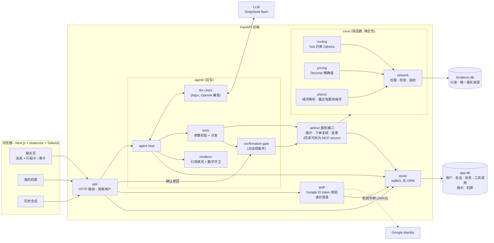
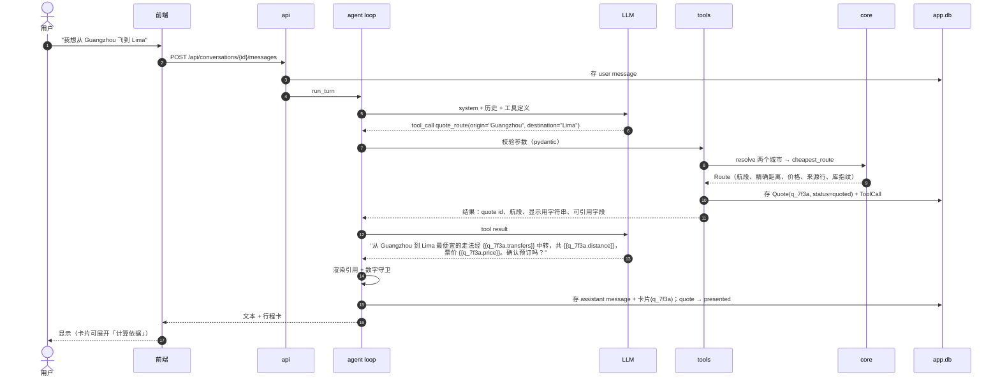
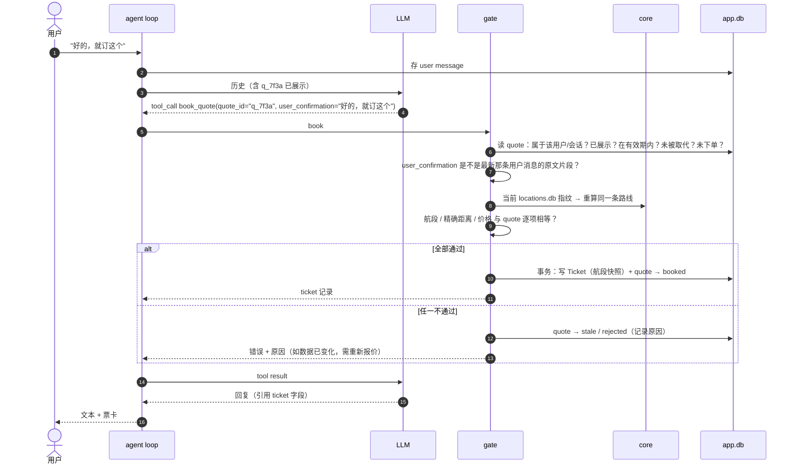
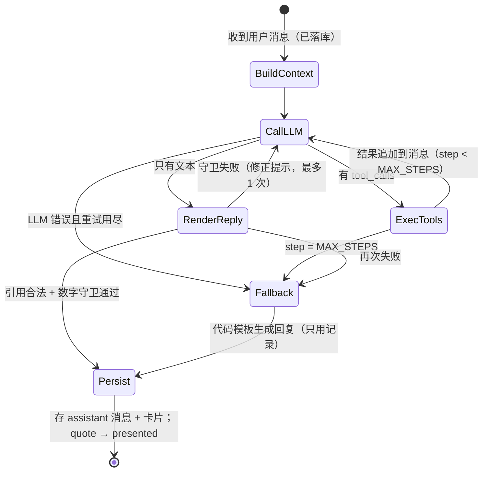
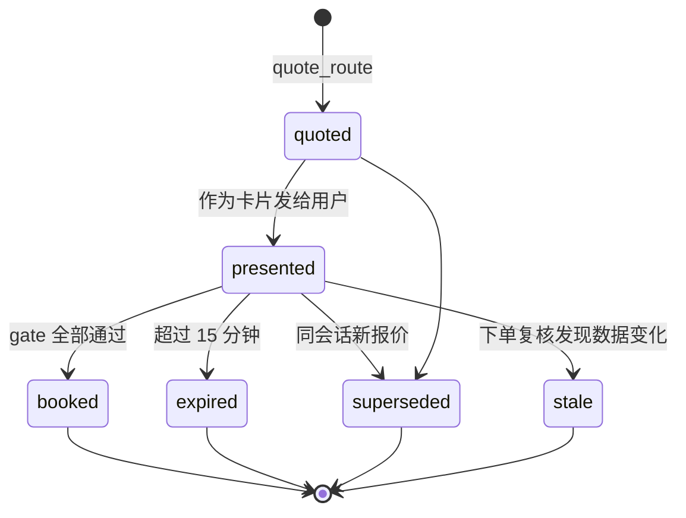
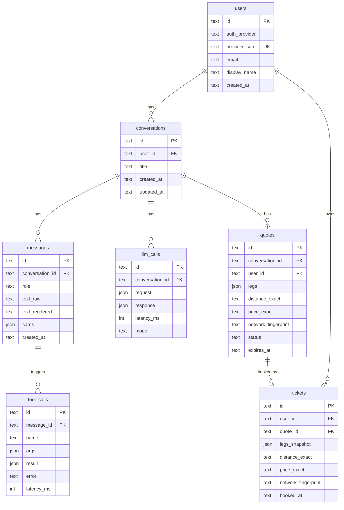

# Ocean Above 订票助手 — 设计文档（草稿 v1，2026-11-23）

> 状态：v0 已 review（§12 三问均确认）；v1 加入流式输出、Google 登录、领域边界（为将来 MCP 预留），**待用户 review**。确认后作为 02–05 迭代的依据；交付前（迭代 05）整理成最终设计文档（覆盖 take-home 要求的
> 5 个部分 + 可选项）。冲突时以 `Quotr Agent Dev Engineer take-home.md` 为准。

## 0. 一句话

用户用自然语言订票。**LLM 只负责理解意图、选择工具、组织语言；路线、距离、价格、票据全部由确定性代码从
`locations.db` 和业务库算出，并以带出处的记录（record）形式存在。** 呈现给用户的每个数字都由代码从记录填入，
可以追溯到具体的数据库行和公式。

## 1. 设计原则

### 1.1 Report 与 compute 分离（参考 FSR, arXiv:2610.25503）

FSR（*From Seeing to Reporting*）指出：模型能逐条列出正确的记录，但在同一个回答里自己「汇报」的汇总数字却会出错
（173 个记录全对，自报的计数加起来却是 188）。它的做法是把回答建模为「回答 → 解码出的记录 → 构造出的集合 → 任务答案」
这条链，**最终答案由代码从记录推导，而不是让模型直接说出来**。

落到本项目：

| FSR 的链条 | 本项目 |
|---|---|
| 模型输出的记录（records） | LLM 只产出**结构化意图**：工具调用和参数（起点、终点、quote id、筛选条件） |
| 解码 / 构造集合 | 确定性代码：解析城市 → 构图 → 最短路 → 航段集合 |
| 任务答案（task answer） | 由代码从航段记录推导：总距离 = Σ 航段距离，价格 = 总距离 × 0.13，票数 = 记录数 |
| 汇报（reporting） | 回复里的数字用**引用占位符**由代码填入；LLM 自己写的数字会被拦下 |

由此得到四条硬规则：
- **P1 LLM 不算数**：任何距离、价格、航段数、票数、中转城市列表都来自工具返回的记录。
- **P2 数字只经引用呈现**：LLM 在文本里写 `{{q_7f3a.price}}` 这样的引用，渲染器从记录取值并格式化；LLM 文本中
  不允许出现引用以外的数字（数字守卫，见 §4.5）。
- **P3 每条记录可溯源**：记录里存数据来源（locations 行、hub_links 行、库指纹）、公式和精确值；界面上可展开查看
  「这个价格怎么来的」。
- **P4 下单只引用记录**：`book_quote` 只接受 quote id；下单时代码对 quote 重新推导一遍，和存档逐项比对（§6）。

### 1.2 其他原则
- `locations.db` 是唯一事实来源，只读打开，不复制数据；文件指纹一变就重载。
- 精确值计算和存储，只在显示时舍入。
- 依赖最小化，agent loop 自己写；图算法用 networkx。
- **领域边界（为将来扩展预留，现在不上 MCP）**：航空公司侧的能力（城市、报价、下单、查票，以及将来的时刻、座位、
  库存）集中在 `airline/` 服务接口后面；agent 只依赖这个接口，不直接碰 core 和数据库。接口的方法、参数、返回记录
  和 LLM 工具一一对应，将来可以原样拆成 MCP server 或接真实订票系统，agent 和评测不用改。
- 流式输出：工具卡片和文本逐步推给前端（§4.7）。
- 未经用户确认完整路线、距离、价格，绝不下单；由服务端强制，不靠 prompt。

## 2. 架构



模块边界：
- `core/` 不知道 LLM、HTTP、app.db 的存在，只吃 `Network` 和参数，返回记录或明确的错误类型。可单独穷举测试。
- `airline/` 是航空公司侧的服务接口：`find_city`、`quote_route`、`book(quote_id, confirmation)`、`list_tickets`，
  内部调 core 和 store；负责下单复核（B1、B5–B7）和权限（只能操作自己的报价和票）。将来的时刻、座位接口也放这里，
  现在**不实现、不编造数据**（locations.db 里没有这些信息）。
- `agent/` 不直接读 locations.db 或 core，只通过 tools → `airline/`。
- 下单只有一个入口：`Gate.book(...)` 先检查对话侧条件（B2–B4），通过后签发确认凭证交给 `airline.book`。LLM 工具和
  界面按钮都走它。
- 所有 LLM 请求和响应、工具调用和结果都落库，既用于「查看历史会话」，也用于溯源和离线评测回放。

## 3. 一轮对话的数据流

### 3.1 询价



### 3.2 确认下单



## 4. Agent loop 设计

### 4.1 状态机



### 4.2 伪代码

```python
def run_turn(conv, user_text) -> AssistantMessage:
    store.add_message(conv, role="user", text=user_text)
    ctx = build_context(conv)             # system prompt + 历史消息 + 历史工具结果（必要时压缩）
    produced = []                         # 本轮产生的记录（quote / ticket / ticket list / city）
    guard_retry = 0
    for step in range(MAX_STEPS):         # MAX_STEPS = 6
        resp = llm.chat(ctx, tools=TOOL_SCHEMAS, temperature=0)   # 超时 + 有限重试
        store.add_llm_call(conv, request=ctx, response=resp)      # 原样保存，便于回放和溯源
        if resp.tool_calls:
            for call in resp.tool_calls:
                result = dispatch(call, conv)    # pydantic 校验 → 执行 → ToolCall 落库
                produced += result.records       # 校验失败也返回结构化错误，让 LLM 自行修正
                ctx.append(tool_message(call.id, result.for_llm()))
            continue
        rendered = renderer.render(resp.text, records=visible_records(conv, produced))
        if rendered.ok:
            return persist_reply(conv, rendered, cards=cards_for(produced))
        if guard_retry == 0:
            guard_retry += 1
            ctx.append(correction(rendered.problems))   # "不要直接写数字，请用 {{id.field}} 引用"
            continue
        break
    return persist_reply(conv, fallback_reply(produced), cards=cards_for(produced))
```

### 4.3 上下文
- system prompt：角色、工具使用规则、「数字只能用引用」、「下单前必须让用户确认完整路线、距离、价格」、
  当前日期。**不放城市列表**（城市由工具解析）。
- 历史：本会话全部消息；工具结果以精简 JSON 保留（记录 id + 可引用字段），超过预算时从最早的轮次开始压缩成摘要，
  quote 和 ticket id 始终保留。
- LLM 参数：`temperature=0`，`tool_choice=auto`，并行工具调用允许（逐个按顺序执行）。

### 4.4 工具

| 工具 | 参数 | 返回的记录 | 为什么这样设计 |
|---|---|---|---|
| `find_city` | `name` | `CityRecord`：规范名、是否有服务、是否 hub、直连 hub；无服务时附 `nearest_served`；找不到时附候选 | 城市名的模糊匹配和「无服务 → 最近有服务城市」（要求 8）是确定性逻辑，不让 LLM 猜城市是否存在 |
| `quote_route` | `origin`, `destination` | `Quote`：航段、中转城市、精确距离、价格、来源、库指纹、有效期 | 询价产生不可变记录；确认和下单引用同一个 id，避免「确认的」和「下单的」不是同一条 |
| `book_quote` | `quote_id`, `user_confirmation`（用户确认原话） | `Ticket` 或拒绝原因 | 唯一的下单工具，服务端闸门校验；要求引用用户原话，让「用户确认了」本身也有出处 |
| `list_my_tickets` | 可选：`city`、`ticket_id`、`booked_after/before` | `TicketList`：票据记录 + `count` | 要求 9：票据只从 app.db 读；数量由代码给出（FSR 的计数教训） |

工具设计取舍：
- **少而粗**：4 个工具覆盖全部需求。`quote_route` 内部自己解析城市；`find_city` 只在用户单独问城市或需要候选时用。
  工具越少，LLM 选错的机会越少，也更容易统计成功率。
- 参数只收**名字和 id**，不收距离、价格等数字，LLM 没有机会把自己算的数传进来。
- 返回给 LLM 的内容同时有显示字符串（已格式化）和引用键，LLM 不需要自己舍入。
- 错误也是结构化记录（`unknown_city` + 候选、`no_service` + 最近城市、`same_city`、`quote_expired`、`stale_data`…），
  LLM 据此组织语言，但事实来自记录。

### 4.5 渲染与数字守卫
- 引用语法：``，如 `{{q_7f3a.price}}` → `$1,234.57`，`{{q_7f3a.route}}` → `Guangzhou → Johannesburg → Lima`，
  `{{tl_2c.count}}` → `3`。只能引用本会话可见的记录和白名单字段。
- 守卫：把引用替换掉以后，LLM 写的文本里如果还有数字（金额、公里数、计数等；日期和 id 由白名单规则处理），
  或引用了不存在的记录或字段，就判失败 → 带具体问题让 LLM 重写一次 → 仍失败则用代码模板回复。
- 卡片（行程卡、票卡）完全由记录渲染，不经过 LLM；即使 LLM 文本出问题，用户看到的核心事实也是对的。

### 4.6 失败处理
| 情况 | 处理 |
|---|---|
| LLM 超时 / 5xx | 指数退避重试 2 次 → 回复「服务暂时不可用」，用户消息保留，可重发 |
| 工具参数不合法 | 结构化错误回给 LLM，计入工具调用成功率的失败 |
| 超过 MAX_STEPS | 模板回复，附本轮已产生的记录 |
| 用户在 LLM 回复前又发消息 | 同一会话串行处理（每会话一把锁） |

### 4.7 流式输出
- 传输：`POST /api/conversations/{id}/messages` 返回 SSE（`text/event-stream`），前端用 fetch 逐段读取。
- 事件：
  | 事件 | 内容 | 时机 |
  |---|---|---|
  | `status` | 「正在查询航线…」等进度 | 每次工具调用前后 |
  | `card` | 行程卡 / 票卡 / 票据列表（完全由记录渲染） | 工具返回后立即推，不等 LLM 写字 |
  | `delta` | 已渲染的文本片段 | LLM 流式输出时 |
  | `replace` | 整条回复替换为代码模板 | 流中途守卫失败时 |
  | `done` / `error` | 消息 id、最终 quote 状态 | 结束 |
- 流式渲染 + 守卫：服务端维护一个小缓冲区，普通文字直接推；遇到 `{{` 暂存到 `}}` 为止，替换为记录值后再推；
  遇到引用之外的数字立即停推，改用模板回复并发 `replace`。白名单：Markdown 有序列表序号、日期、记录 id。
- LLM 的工具调用参数在流里是分片的，后端拼完整后才执行。
- 落库的是最终版本（`text_raw` + `text_rendered`）；quote 在 `done` 前才置为 `presented`。
- 断线：后端照常跑完一轮并落库，前端重连后拉会话即可看到完整结果。

## 5. 路线、距离、价格

- 图：hub–hub 边来自 `hub_links`，非 hub–hub 边来自 `connected_hubs`；双向。非 hub 城市只能当端点（只在 hub 换乘）。
- 每段距离 = `Decimal(dx² + dy²).sqrt()`（坐标为整数，50 位精度）；总距离 = 各段精确值之和；价格 = 总距离 × `Decimal("0.13")`。
- 价格和距离成正比 ⇒ 最便宜 = 最短；欧氏距离满足三角不等式 ⇒ 有直飞时直飞最便宜（要求 5 自然满足）。
- 算法：networkx Dijkstra；等成本时取航段最少，再按城市名序，结果确定、可复现。
- 显示：距离 1 位小数（km），价格到分（ROUND_HALF_UP）；**舍入只发生在渲染层**，存储和比较都用精确值。
- 正确性保证：
  1. 独立手写的参考实现（Floyd-Warshall + 枚举端点 hub）与 networkx 结果在**全部有服务城市对**上比对成本；
  2. hypothesis 随机图（不连通、平手、共线）；
  3. 结构性检查：中间城市都是 hub、每段都是真实航线、总距离 = 各段之和、价格 = 距离 × 0.13；
  4. 呈现侧：数字只能经引用渲染（§4.5），评测里再查一遍「回复中的每个数字都能在记录里找到」。

### 5.1 溯源记录（Quote 示例）

```json
{
  "id": "q_7f3a",
  "origin": "Guangzhou", "destination": "Lima",
  "legs": [
    {"from": "Guangzhou", "to": "Johannesburg",
     "from_coord": [-9278, 3445], "to_coord": [...],
     "source": "locations.connected_hubs(Guangzhou)",
     "distance_exact": "…(50 位)…"},
    {"from": "Johannesburg", "to": "…", "source": "hub_links(…,…)", "distance_exact": "…"}
  ],
  "transfers": ["Johannesburg", "…"],
  "distance_exact": "Σ legs",
  "price_exact": "distance_exact × 0.13",
  "formula": "price = Σ sqrt(dx²+dy²) × 0.13 USD",
  "network_fingerprint": "sha256:…",
  "algorithm": "dijkstra(networkx 3.x), tie-break: legs, name",
  "status": "quoted | presented | booked | expired | superseded | stale",
  "created_at": "…", "expires_at": "+15 min"
}
```
（示例中的城市和数字仅示意，非真实结果。）

界面的「计算依据」展开后显示：每段的两端坐标、来源（哪条航线记录）、每段距离、求和、× 0.13、所用数据版本。

## 6. 确认与下单（要求 7）



Gate 条件（全部满足才下单；编号规则写入 `docs/design/state_invariants.md`，用模型测试覆盖）：
- **B1** quote 属于当前用户和当前会话。
- **B2** quote 状态为 `presented`：它已作为行程卡（完整航段、中转城市、距离、价格）展示给用户。
- **B3** 展示之后存在一条用户消息（按钮下单本身就是这条用户动作）。
- **B4** `user_confirmation` 是最新一条用户消息的原文片段（LLM 路径）；按钮路径带 quote id。
- **B5** 未过期（15 分钟）、未被取代、未下过单（幂等：同一 quote 最多一张票）。
- **B6** 复核：当前 locations.db 指纹下重算同一起终点，航段、精确距离、价格与 quote 完全一致；否则置为 `stale`，
  给出新报价，要求重新确认。
- **B7** 写票和改 quote 状态在同一个数据库事务里。

分工：B2–B4 是对话侧条件，由 agent 的 Gate 检查，通过后签发确认凭证（quote id、用户、确认所在的用户消息 id）；
B1、B5–B7 是航空公司侧条件，由 `airline.book` 检查（它必须收到凭证才下单）。现在两者在同一进程，将来 `airline/`
拆成独立服务（如 MCP server）时，分工不变，凭证改为签名令牌。

LLM 层面的辅助（不作为安全依据）：prompt 要求先展示后确认；评测里有「含糊回复不应下单」「改了目的地后旧报价不能下单」等轨迹用例。

## 7. 数据模型（app.db）



- 精确值存成十进制字符串；`text_raw`（LLM 原文，含引用）和 `text_rendered`（渲染后）都存，方便溯源。
- 用户系统（§8.1）：Google 登录为主，演示登录为辅；`(auth_provider, provider_sub)` 唯一标识用户。

## 8. API（草案，03 迭代定稿）

| 方法 | 路径 | 用途 |
|---|---|---|
| POST | `/api/auth/google` | 提交 Google ID token，后端核验后发会话 cookie |
| POST | `/api/auth/demo` | 演示登录（仅 `DEMO_LOGIN=1` 时启用） |
| POST | `/api/auth/logout` | 退出 |
| GET | `/api/me` | 当前用户 |
| GET | `/api/conversations` | 会话列表（要求 10） |
| POST | `/api/conversations` | 新会话 |
| GET | `/api/conversations/{id}` | 会话全部消息 + 卡片 |
| POST | `/api/conversations/{id}/messages` | 发消息，SSE 流式返回（§4.7） |
| POST | `/api/quotes/{id}/book` | 行程卡上的确认按钮（同一个 gate） |
| GET | `/api/quotes/{id}/trace` | 计算依据 |
| GET | `/api/tickets` | 我的机票（要求 9） |

### 8.1 登录
- 前端用 Google Identity Services 的登录按钮拿到 **ID token**（不走授权码流程，不需要 client secret，
  不申请任何 Google API 权限，只要 `openid email profile`）。
- 后端核验 ID token：用 Google 公布的 JWKS 验签，检查 `aud` = 我们的 client ID、`iss`、`exp`、`email_verified`；
  通过后发**自己的** httpOnly、SameSite=Lax 会话 cookie（服务端会话表或签名 cookie），之后不再依赖 Google。
  依赖：`google-auth`（官方库，做验签）或 `PyJWT[crypto]` + JWKS 缓存，在 04 开工时选一个并写明理由。
- 演示登录：`DEMO_LOGIN=1` 时显示「用用户名进入」，方便评审在本地无 Google 配置时运行；线上可关。
- 配置：`GOOGLE_CLIENT_ID`（后端）和 `NEXT_PUBLIC_GOOGLE_CLIENT_ID`（前端，同一个值，非机密）。
- 限制：Google 只接受 `http://localhost` 或 https 域名作为 JavaScript 来源；用局域网 IP（0.0.0.0 绑定后从别的机器访问）
  打开时 Google 登录不可用，用演示登录或 localhost。

## 9. 前端

- 页面：登录、聊天（会话列表 + 对话 + 卡片）、我的机票、历史会话只读查看。
- shadcn/ui + Tailwind；移动端：会话列表变抽屉、卡片单列、触控目标 ≥ 44px、无横向滚动。
- Markdown 流式渲染：优先 Vercel `streamdown`（react-markdown 的流式替代，处理未闭合的 Markdown、按块增量渲染）；
  开工前核实体积，只启用需要的部分（不要代码高亮、数学公式、mermaid）；不合适则用 `react-markdown` + 按块 memo。
- 文本里引用已在服务端渲染好，前端不做数字处理；卡片是独立组件，不经过 Markdown。
- 行程卡：起点 → 中转 → 终点的航段列表、每段距离、总距离、价格、有效期倒计时、「确认预订」按钮、可展开「计算依据」。
- 审查：Impeccable（critique / audit / detect）+ shadcn 对应 skill；ego-browser 桌面和手机截图。

## 10. 测试与评测

| 层 | 内容 | 何时跑 |
|---|---|---|
| core 单元 + 属性测试 | 距离、价格、舍入、路线规则、参考实现全对比对、随机图 | 每次 |
| gate 不变式模型测试 | B1–B7：随机事件序列（报价、展示、用户消息、按钮、时钟推进、改库、重复下单）每步检查 | 每次 |
| agent 回放测试 | 脚本化假 LLM：loop、分发、守卫、回退、闸门 | 每次 |
| API 测试 | httpx TestClient 走完整流程 | 每次 |
| LLM 评测 `backend/evals/` | 工具调用成功率（每用例 N 次，按工具统计，有阈值）；整段轨迹（工具序列 + 不变式：未确认不下单、数字都有出处、无服务给最近城市、查票走工具） | 按需；单次估算 < $1 直接跑 |
| UI | ego-browser 桌面 + 手机截图；Impeccable | 04 起每个 UI 改动 |

## 11. 已知限制与下一步（初稿）

- 无航班日期、时刻、座位、乘客信息、支付、退改签（take-home 未要求；写进「真实上线还需要什么」）。
- 用户系统只有用户名，无认证。
- 自然语言确认依赖 LLM 判断意图；闸门保证「被确认的就是被展示的那张报价」，但「这句话算不算确认」仍可能误判 →
  按钮路径作为兜底，评测覆盖含糊用例。
- 数字守卫可能误伤（如用户自己提到的数字）→ 白名单 + 回退模板。
- 单进程 SQLite；部署 Cloudflare 时需评估 Python Workers + D1 的适配（部署前再问）。
- 航班时刻、座位、库存：接口位置预留在 `airline/`，现在不实现、不编造。
- 下一步候选：把 `airline/` 拆成 MCP server（权限、真实订票系统对接）、多乘客、日期和库存、多语言、支付、
  管理端改航线后的通知。

## 12. 决定记录
- 2026-11-23 v0 review：引用占位符 + 数字守卫符合 FSR 思路 ✔；`book_quote` 带用户确认原话（B4）✔；中文草稿，05 出英文版 ✔。
- 2026-11-23：流式输出提前到 03；Markdown 流式渲染组件（`streamdown` 优先）；Google 登录现在就做（04），
  用户自己在 GCP 建凭证；MCP 对当前版本 overkill，不做，只保留 `airline/` 领域边界便于将来拆分。

## 13. 待你决定 / review 的点
1. 保留演示登录（`DEMO_LOGIN=1`）作为评审本地运行的兜底，可以吗？
