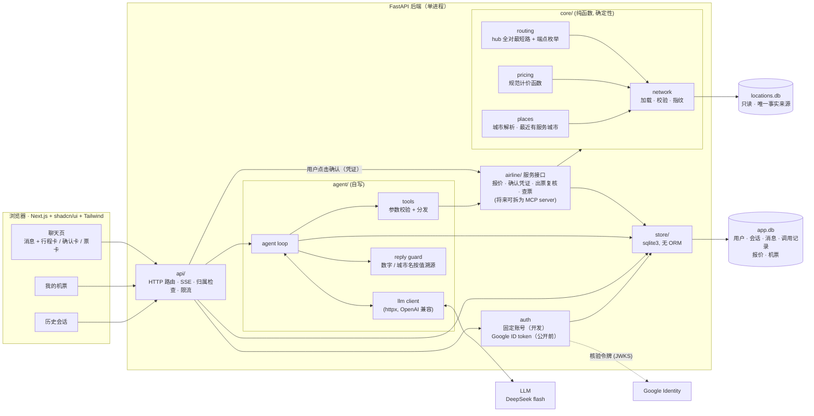
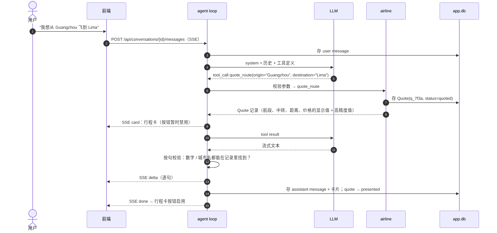
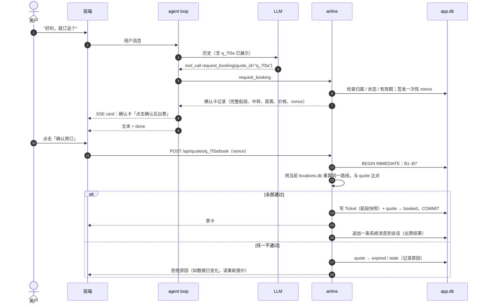
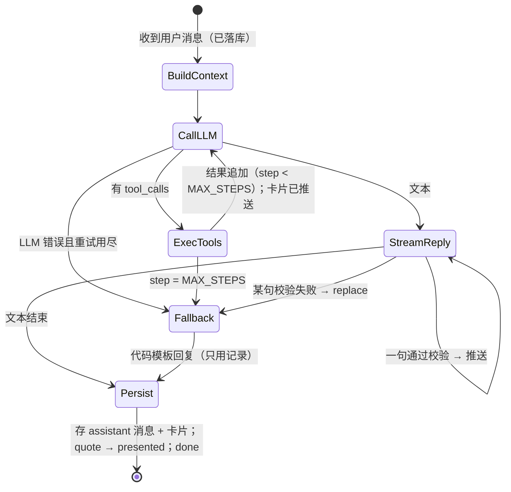
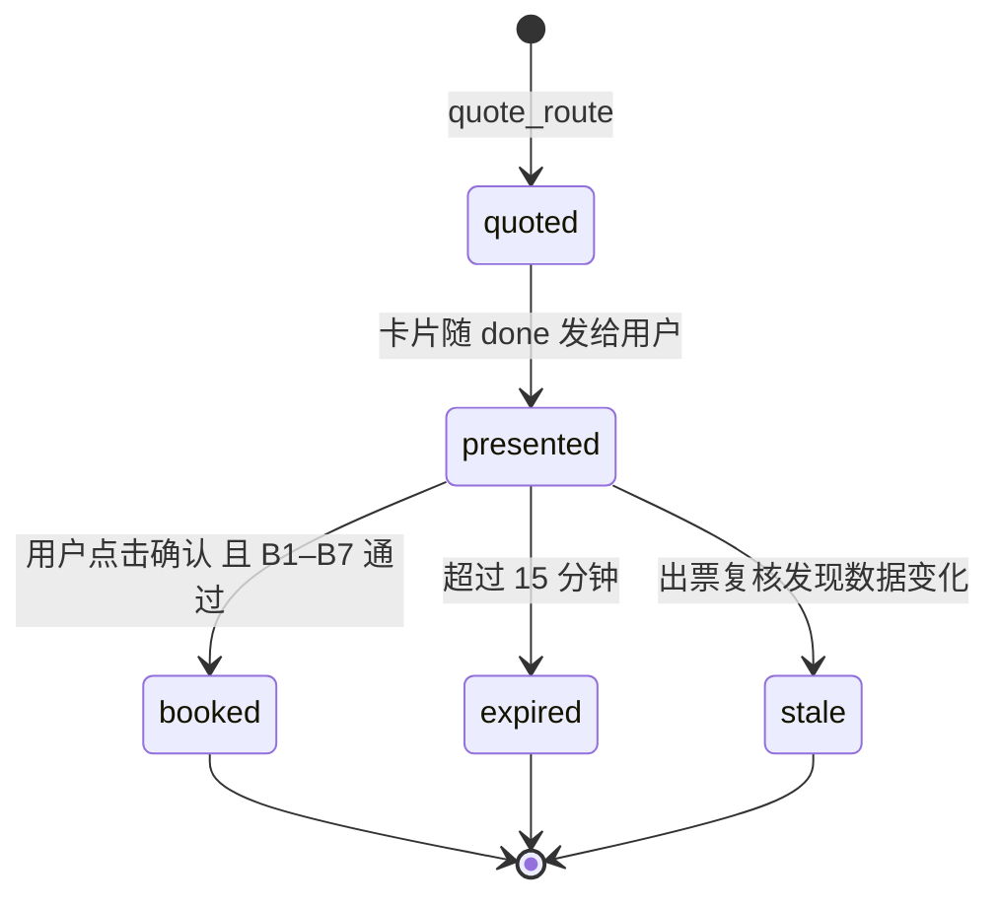
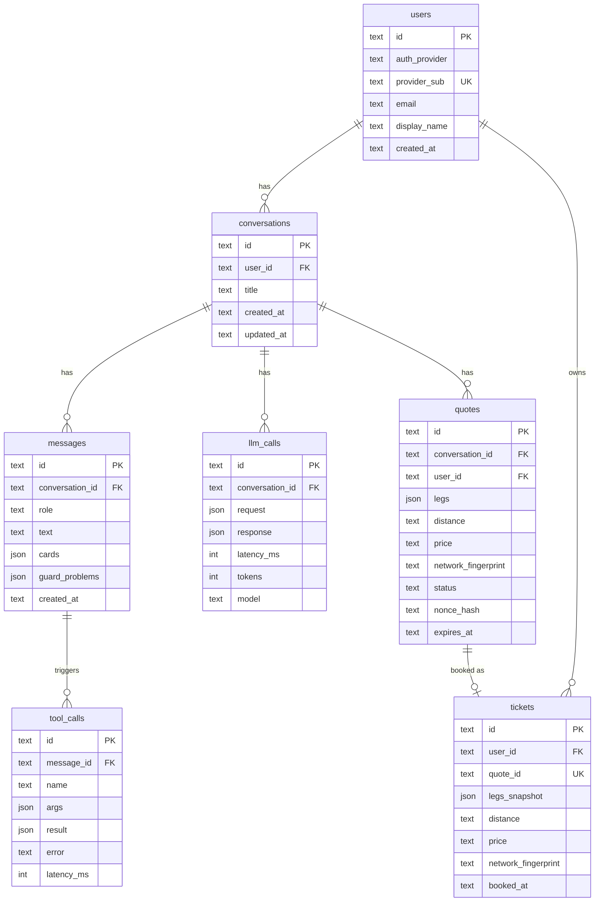
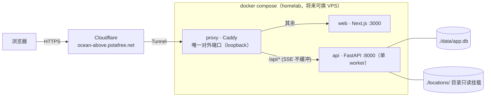

# Ocean Above 订票助手 — 设计文档（草稿 v2，2026-11-23）

> 状态：v2 = v1 + 设计评审（Fable 5.2，2 P0 / 7 P1 / 9 P2）全部按推荐修改，用户已确认推荐方案。
> 中文工作稿；最终交付版（英文）按 take-home 要求的 5 个标题组织。冲突时以 `Quotr Agent Dev Engineer take-home.md` 为准。

## 0. 一句话

用户用自然语言订票。**LLM 只负责理解意图、选择工具、组织语言；路线、距离、价格、票据全部由确定性代码从
`locations.db` 和业务库算出，并以带出处的记录（record）形式存在。** 用户看到的每个数字和城市都能在记录里找到，
记录可以追溯到具体的数据库行和公式。**出票只能由用户点击确认按钮触发**，LLM 没有出票能力。

## 1. 设计原则

### 1.1 Report 与 compute 分离（参考 FSR, arXiv:2610.25503）

FSR（*From Seeing to Reporting*）指出：模型能逐条列出正确的记录，但在同一个回答里自己「汇报」的汇总数字却会出错
（173 个记录全对，自报的计数加起来却是 188）。它的做法是把回答建模为「回答 → 解码出的记录 → 构造出的集合 → 任务答案」
这条链，**最终答案由代码从记录推导，而不是让模型直接说出来**。

| FSR 的链条 | 本项目 |
|---|---|
| 模型输出的记录（records） | LLM 只产出**结构化意图**：工具调用和参数（城市名、quote id、筛选条件） |
| 解码 / 构造集合 | 确定性代码：解析城市 → 最短路 → 航段集合 |
| 任务答案（task answer） | 由代码从航段记录推导：总距离 = Σ 航段距离，价格 = 总距离 × 0.13，票数 = 记录数 |
| 汇报（reporting） | 事实以**卡片**呈现（完全由记录渲染）；LLM 文本里的每个数字、每个城市名都要能在记录里找到，否则不发出 |

硬规则：
- **P1 LLM 不算数**：距离、价格、航段、票数、中转城市、最近有服务城市都来自工具返回的记录。
- **P2 文本按值溯源**：LLM 文本里的每个数字必须等于本轮可见记录里的某个显示值；每个库内城市名必须出现在本轮记录
  或用户消息里。否则不发出这段文本（§4.5）。
- **P3 每条记录可溯源**：记录里存数据来源（locations 行、hub_links 行、库指纹）、公式和高精度值；界面可展开
  「这个价格怎么来的」。
- **P4 出票只由用户点击触发**：LLM 只能「请求下单」（让界面出确认卡），出票接口只接受用户点击带来的一次性确认凭证；
  出票时代码对 quote 重新推导，和存档比对（§6）。

### 1.2 其他原则
- `locations.db` 是唯一事实来源，只读打开，不复制数据；文件指纹一变就重载。
- **高精度计算（50 位）和存储，只在显示时舍入**；全系统只有一个规范的计价函数（§5）。
- 依赖最小化，agent loop 自己写；图算法用 networkx。
- **领域边界（为将来扩展预留，现在不上 MCP）**：航空公司侧能力（城市、报价、出票、查票，将来的时刻 / 座位 / 库存）
  集中在 `airline/` 服务接口后面；agent 只依赖这个接口。将来可原样拆成 MCP server 或接真实订票系统。
- 流式输出：卡片在工具返回后立即推送，文本按句校验后推送（§4.7）。
- 先交付必交物：03 结束时就有可本地运行的端到端版本，README 和设计文档每个迭代增量更新。

## 2. 架构



模块边界：
- `core/` 不知道 LLM、HTTP、app.db，只吃 `Network` 和参数，返回记录或明确的错误类型。可单独穷举测试。
- `airline/`：`find_city`、`quote_route`、`request_booking`（签发确认凭证）、`book(quote_id, nonce)`（出票）、
  `list_tickets`；内部调 core 和 store，负责出票条件 B1–B7 和权限（只能操作自己的报价和票）。时刻、座位接口位置预留，
  **不实现、不编造数据**（locations.db 里没有这些信息）。
- `agent/` 不直接读 locations.db 或 core，只通过 tools → `airline/`。**agent 没有任何出票路径**。
- 所有 LLM 请求和响应、工具调用和结果都落库：用于「查看历史会话」、溯源和离线评测回放。

## 3. 一轮对话的数据流

### 3.1 询价



### 3.2 确认出票



用户也可以直接点行程卡上的「确认预订」按钮（行程卡本身就展示了完整路线、距离、价格，展示时同样签发 nonce）。
无论哪条路，**出票的触发都是用户的一次点击**，LLM 只能让确认卡出现。

## 4. Agent loop 设计

### 4.1 状态机



### 4.2 伪代码

```python
def run_turn(conv, user_text, emit) -> AssistantMessage:
    with conversation_lock(conv):                  # 同会话串行；出票接口也拿同一把锁
        store.add_message(conv, role="user", text=user_text)
        ctx = build_context(conv)                  # system + 历史（LLM 原文）+ 历史工具结果（精简）
        produced = []                              # 本轮记录：quote / booking request / ticket list / city
        for step in range(MAX_STEPS):              # MAX_STEPS = 6
            stream = llm.chat_stream(ctx, tools=TOOL_SCHEMAS, temperature=0)
            if stream.tool_calls():                # 分片的参数拼完整后再执行
                for call in stream.tool_calls():
                    emit("status", status_text(call))
                    result = dispatch(call, conv)  # pydantic 校验 → airline → ToolCall 落库
                    produced += result.records     # 校验失败也返回结构化错误，让 LLM 自行修正
                    for card in cards_for(result.records):
                        emit("card", card)         # 卡片立即推送，按钮在 done 前禁用
                    ctx.append(tool_message(call.id, result.for_llm()))
                store.add_llm_call(conv, ctx, stream.raw())
                continue
            guard = ReplyGuard(records=visible_records(conv, produced), user_text=user_text)
            for sentence in stream.sentences():    # 按句缓冲
                ok, problems = guard.check(sentence)
                if not ok:
                    emit("replace", fallback_reply(produced))
                    return persist(conv, fallback_reply(produced), produced, guard_problems=problems)
                emit("delta", sentence)
            store.add_llm_call(conv, ctx, stream.raw())
            return persist(conv, stream.text(), produced)
        emit("replace", fallback_reply(produced))
        return persist(conv, fallback_reply(produced), produced)
```

### 4.3 上下文
- system prompt：角色；工具使用规则；「事实在卡片里，文字里不要自己算数，提到数字只能照抄工具结果的显示值」；
  「用户要订票时调用 `request_booking`，告诉用户点击确认卡出票」；「城市名有歧义时先问用户」；当前日期。
  **不放城市列表**（城市由工具解析）。
- 历史：本会话全部消息，**用 LLM 原文**（与渲染后一致，因为文本不再做替换）；工具结果以精简 JSON 保留
  （记录 id + 显示值），超过预算时从最早的轮次开始压缩成摘要，quote 和 ticket id 始终保留。
- LLM 参数：`temperature=0`，`tool_choice=auto`；并行工具调用允许（按顺序执行）。

### 4.4 工具

| 工具 | 参数 | 返回的记录 | 为什么这样设计 |
|---|---|---|---|
| `find_city` | `name` | `CityRecord`：规范名、是否有服务、是否 hub、直连 hub；无服务时附最近的有服务城市（前 3 个）；找不到或有歧义时附候选 | 城市解析和「无服务 → 最近有服务城市」（要求 8）是确定性逻辑；歧义（如 `San Jose` / `San José`）返回 `ambiguous_city`，由用户选 |
| `quote_route` | `origin`, `destination` | `Quote`：航段、中转、距离、价格（显示值 + 高精度值）、来源、库指纹、有效期；错误：`unknown_city` / `ambiguous_city` / `same_city` / `no_service`（附最近有服务城市，排除另一端）/ `unreachable` | 询价产生不可变记录；确认卡、出票都引用同一个 id |
| `request_booking` | `quote_id` | `BookingRequest`：确认卡（完整航段、中转、距离、价格、有效期）+ 一次性 nonce | LLM 只能让确认卡出现，不能出票；出票的触发是用户点击（P4） |
| `list_my_tickets` | 可选：`city`、`ticket_id`、`booked_after/before` | `TicketList`：票据记录 + `count` | 要求 9：票据只从 app.db 读；数量由代码给出（FSR 的计数教训） |

工具设计取舍：
- **少而粗**：4 个工具覆盖全部需求。工具越少，LLM 选错的机会越少，也更容易统计成功率。
- 参数只收**名字和 id**，不收距离、价格等数字，LLM 没有机会把自己算的数传进来。
- 返回给 LLM 的都是已格式化的显示值，LLM 不需要也不应该自己舍入或换算。
- 错误也是结构化记录，LLM 据此组织语言，但事实来自记录；**无服务、歧义、找不到也各有一张卡片**，
  即使 LLM 文字写错，卡片上的事实是对的。

### 4.5 回复校验（ReplyGuard）
- **数字按值溯源**：句子里每个数字（含金额、公里数、计数）规范化后必须等于本轮可见记录的某个显示值
  （如 `$1,234.57`、`9,497.3 km`、`3`）。另外允许：用户本条消息里原样出现过的数字、Markdown 有序列表序号、
  记录 id、日期。
- **城市名按值溯源**：句子里出现的任何库内城市名，必须出现在本轮记录里或用户本条消息里（防止 LLM 用常识推荐
  「附近的 Dubai」——库里 Abu Dhabi 最近的有服务城市是 Tirana）。
- 失败：流式下已推出的句子无法撤回，所以**不重写**，直接 `replace` 成代码模板回复（模板只用记录拼句子）。
  失败原因落库，计入评测指标。
- 已知漏洞：文字写出的数（「两千多公里」「three tickets」）看不出来 → prompt 禁止 + 评测检查 + 写入已知限制。
- 03 开工第一步：用约 20 个用例在 DeepSeek flash 上实测校验通过率和回退率，再定 prompt；如回退率过高，改为
  「文字不写任何数字，事实全在卡片」。

### 4.6 失败处理
| 情况 | 处理 |
|---|---|
| LLM 超时 / 5xx | 指数退避重试 2 次 → 回复「服务暂时不可用」，用户消息保留，可重发 |
| 工具参数不合法 | 结构化错误回给 LLM，计入工具调用成功率的失败 |
| 超过 MAX_STEPS | 模板回复，附本轮已产生的记录 |
| 用户在回复完成前又发消息 / 点按钮 | 同会话串行（每会话一把锁，聊天和出票接口共用）；uvicorn 单 worker |
| 超出限额 | 明确提示（每用户每日消息上限、全站每日预算） |

### 4.7 流式输出
- 传输：`POST /api/conversations/{id}/messages` 返回 SSE（`text/event-stream`），前端用 fetch 逐段读取。
- 事件：
  | 事件 | 内容 | 时机 |
  |---|---|---|
  | `status` | 「正在查询航线…」等进度 | 每次工具调用前 |
  | `card` | 行程卡 / 确认卡 / 票卡 / 无服务卡 / 歧义卡（完全由记录渲染） | 工具返回后立即推 |
  | `delta` | 通过校验的一句文本 | LLM 流式输出时，按句 |
  | `replace` | 整条文本替换为代码模板 | 某句校验失败 |
  | `ping` | 心跳 | 每 15 秒（防止 Cloudflare 断开空闲连接） |
  | `done` / `error` | 消息 id、各卡片的服务端状态 | 结束 |
- 卡片按钮在 `done` 之前禁用；之后的按钮状态（可订 / 已出票 / 已过期）一律以服务端当前 quote 状态为准，
  包括断线重连后拉到的历史卡片。
- 断线：后端照常跑完一轮并落库，前端重连后拉会话即可看到完整结果。

## 5. 路线、距离、价格

- 图：hub–hub 边来自 `hub_links`，非 hub–hub 边来自 `connected_hubs`；双向。非 hub 城市只能当端点（只在 hub 换乘）。
- 价格和距离成正比 ⇒ 最便宜 = 最短；欧氏距离满足三角不等式 ⇒ 有直飞时直飞最便宜（要求 5 自然满足）。
- **规范计价函数**（全系统唯一，报价、出票复核、参考比对都只用它）：给定城市序列，在固定的 Decimal 上下文
  （prec=50, ROUND_HALF_EVEN）里按航段顺序计算 `sqrt(dx²+dy²)`、求和、乘 `Decimal("0.13")`，量化为 30 位小数的字符串。
  坐标是整数，只有完全平方数的航段距离是精确值，其余是 50 位精度近似；文档和界面都称「高精度值」。
- 选路：加载（或库指纹变化）时，对每个 hub 对用 networkx `shortest_simple_paths`（Yen）取出「整数边权最优 + 很小容差」
  内的全部简单路径作为候选（边权 = 规范单段距离量化到 1e-30 后的整数，整数运算无误差；容差只会多收候选，
  保证 √2+√8 对 √18 这类无理数平手不被漏掉）。查询时枚举「起点直连 hub × 终点直连 hub」拼出候选路线，全部交给规范函数
  计价，按（价格，航段数，城市名序列）取最小。**networkx 只用来产生候选，不使用它返回的长度。**
  实测：真实库每个 hub 对恰好 1 条候选，加载约 0.12 s；全部 490,700 个有服务城市对与参考实现比对一致，用时约 28 s。
- 存储值上「各段之和」与「总距离」可能相差 ≤ 航段数 × 1e-30（先对未舍入值求和再量化一次，避免把舍入值喂回计算）；
  「计算依据」以总距离字段为准。
- 显示：距离 1 位小数（km），价格到分（ROUND_HALF_UP）；舍入只在渲染层。「计算依据」显示每段高精度距离、求和、
  × 0.13，并注明「价格按未舍入的距离计算，所以显示距离 × 0.13 可能和显示价格差 1 分」。
- 城市解析：先按原样（NFC）精确匹配；不中再做大小写 + 去重音折叠匹配，折叠后命中多个（库里唯一的一组是
  `San Jose` 与 `San José`）→ `ambiguous_city`，绝不自动选；仍不中 → difflib 候选。命中的城市如有折叠同名的兄弟，
  记录里带 `similar_names`，卡片显示区分信息（直连 hub）。
- 最近有服务城市：在有服务城市中按距离取前 3 个，可排除指定城市（避免建议的城市就是另一端）。
- 正确性保证：
  1. 独立参考实现（逐对 Bellman-Ford，不共享代码）与生产实现在**全部有服务城市对**上比对路线成本；
  2. hypothesis 随机图（不连通、平手、共线）；
  3. 结构性检查：中间城市都是 hub、每段都是真实航线、总距离 = 各段之和、价格 = 距离 × 0.13；
  4. 线程一致性：默认上下文的新线程里算出的报价字符串与主线程逐字节相同；
  5. 呈现侧：卡片只由记录渲染；文本经 ReplyGuard（§4.5）；评测再查一遍「回复中每个数字、城市都能在记录里找到」。

### 5.1 溯源记录（Quote 示例）

```json
{
  "id": "q_7f3a",
  "origin": "Guangzhou", "destination": "Lima",
  "legs": [
    {"from": "Guangzhou", "to": "Johannesburg",
     "from_coord": [-9278, 3445], "to_coord": [...],
     "source": "locations.connected_hubs(Guangzhou)",
     "distance": "…(30 位小数)…"},
    {"from": "Johannesburg", "to": "…", "source": "hub_links(…,…)", "distance": "…"}
  ],
  "transfers": ["Johannesburg", "…"],
  "distance": "Σ legs",
  "price": "distance × 0.13",
  "display": {"distance": "…km", "price": "$…"},
  "formula": "price = Σ sqrt(dx²+dy²) × 0.13 USD; Decimal prec 50, stored to 30 dp",
  "network_fingerprint": "sha256:…",
  "algorithm": "hub all-pairs (networkx) + endpoint enumeration; tie-break: legs, names",
  "status": "quoted | presented | booked | expired | stale",
  "created_at": "…", "expires_at": "+15 min"
}
```
（示例中的城市和数字仅示意，非真实结果。）

## 6. 确认与出票（要求 7）



没有「取代」：同一会话可以同时存在多张有效报价（比较两条航线、往返各一张都正常）。

出票条件（全部满足才出票；编号规则在 `docs/design/state_invariants.md`，用模型测试覆盖）：
- **B1 归属**：quote 属于当前登录用户。
- **B2 已展示**：quote 状态为 `presented`，即带完整航段、中转、距离、价格的卡片已随 `done` 发给用户。
- **B3 用户点击**：请求来自出票接口，携带该卡片签发的一次性 nonce（nonce 绑定 quote、用户、卡片所在消息；用一次即失效）。
  LLM 没有调用出票接口的路径。
- **B4 有效期**：未超过 15 分钟。
- **B5 幂等**：同一 quote 最多一张票（`tickets.quote_id` UNIQUE）。
- **B6 复核**：用当前 locations.db（指纹检查，必要时重载）重算同一城市序列：每段两端城市和坐标与 quote 一致、
  该航段仍存在，规范函数算出的距离和价格与存档字符串相等；起终点的最便宜路线仍是这条。否则 quote → `stale`，
  提示重新报价，用户需重新确认。
- **B7 原子性**：`BEGIN IMMEDIATE` 事务内完成检查、写票、改 quote 状态；聊天和出票接口共用会话锁；uvicorn 单 worker。

如何回答 take-home 的「怎么保证未经确认不出票」：出票只有一个接口，只接受用户点击带来的 nonce，而 nonce 只在
完整路线 / 距离 / 价格的卡片发给用户之后才签发；LLM 能做的只是让这张卡片出现。自然语言里的「好的，订吧」
会让确认卡出现，但不会出票。

## 7. 数据模型（app.db）



- 距离、价格存成高精度十进制字符串（规范函数的输出），显示值不入库参与计算。
- `app.db` 在 `data/` 目录，不进 git（含用户邮箱、全部对话）。
- 用户：`(auth_provider, provider_sub)` 唯一；固定账号是 `auth_provider = "dev"`。

## 8. API

| 方法 | 路径 | 用途 |
|---|---|---|
| POST | `/api/auth/dev` | 固定账号登录（环境变量开关；本地 / 开发） |
| POST | `/api/auth/google` | 提交 Google ID token，后端核验后发会话 cookie（05） |
| POST | `/api/auth/logout` | 退出 |
| GET | `/api/me` | 当前用户 |
| GET | `/api/config` | 前端运行时配置（如 Google client ID，避免构建时写死） |
| GET | `/api/conversations` | 会话列表（要求 10） |
| POST | `/api/conversations` | 新会话 |
| GET | `/api/conversations/{id}` | 会话全部消息 + 卡片（卡片状态以服务端为准） |
| POST | `/api/conversations/{id}/messages` | 发消息，SSE 流式返回（§4.7） |
| POST | `/api/quotes/{id}/book` | 用户点击确认出票（带 nonce；B1–B7） |
| GET | `/api/quotes/{id}/trace` | 计算依据 |
| GET | `/api/tickets` | 我的机票（要求 9） |

**所有带 id 的读写接口都检查归属**（不是自己的返回 404），不只是出票。

### 8.1 登录
- **分两步**：开发期和本地运行用固定账号（`DEV_AUTH_USER` / `DEV_AUTH_PASSWORD`，来自 `.env`，环境变量开关）；
  数据从第一天起就按多用户设计。demo 公开前（05）接入 Google 登录并走通多用户流程。
- Google 登录：前端用 Google Identity Services 拿 **ID token**（不需要 client secret，只要 `openid email profile`）；
  后端用 Google JWKS 验签，检查 `aud`、`iss`、`exp`、`email_verified`，通过后发**自己的** httpOnly 会话 cookie
  （`Secure` 按环境开关：Caddy 后面是 http，经 Cloudflare 对外是 https）。依赖在 05 开工时选（`google-auth` 或
  `PyJWT[crypto]`）并写明理由。设计文档要写清楚这个第三方登录怎么工作（take-home 非必须项第 2 条）。
- 评审：OAuth 应用必须发布为 Production（Testing 状态只有名单内用户能登录）；另给评审一个不依赖 Google 的入口
  （邀请码登录，带限额）。
- Google 只接受 `http://localhost` 或 https 域名作为 JavaScript 来源；用局域网 IP 访问时只能用固定账号。

### 8.2 限额（公开 demo 前必须有）
- 每用户每日消息数上限、全站每日 token / 费用预算（按 `llm_calls.tokens` 累计），到顶后明确提示；
  LLM 服务商侧也设消费上限。

### 8.3 部署与交付

- 交付物：本地 `docker compose up` 后打开 `http://localhost:3000`；demo 站点用同一份 compose（`OCEAN_PORT=18765`）。
- 评审本地运行需要一个 OpenAI 兼容的 LLM key（README 写明怎么配）；或直接用线上 demo。
- 同源：前端只请求相对路径 `/api/*`；开发时 Next.js 把 `/api` 转给本地后端。
- `locations.db` 所在**目录**只读挂载（单文件挂载在宿主机替换文件后容器看不到新文件，指纹重载会失效）。
- 前端配置运行时从 `/api/config` 取，同一个镜像可用于本地和 demo。
- 日志 stdout/stderr，json-file 轮转 10m × 3；`restart: unless-stopped`。细节见 `docs/deploy.md`。

## 9. 前端

- 页面：登录、聊天（会话列表 + 对话 + 卡片）、我的机票、历史会话只读查看。
- shadcn/ui + Tailwind；移动端：会话列表变抽屉、卡片单列、触控目标 ≥ 44px、无横向滚动。
- Markdown 流式渲染：优先 Vercel `streamdown`，开工前核实体积，只启用需要的部分；不合适则 `react-markdown` + 按块 memo。
- 卡片是独立组件，不经过 Markdown：行程卡（航段、每段距离、总距离、价格、有效期倒计时、「确认预订」、可展开「计算依据」）、
  确认卡、票卡、无服务卡（「X 暂无航班，最近的有服务城市是 …」）、歧义卡（列出候选及区分信息）。
- 审查：Impeccable（critique / audit / detect）+ shadcn 对应 skill；ego-browser 桌面和手机截图。

## 10. 测试与评测

| 层 | 内容 | 何时跑 |
|---|---|---|
| core 单元 + 属性测试 | 规范计价、舍入、路线规则、城市解析（含 San Jose / San José）、参考实现全对比对、随机图、线程一致性 | 每次 |
| 出票不变式模型测试 | B1–B7：随机事件序列（报价、展示、用户消息、LLM 请求下单、点击、重复点击、并发点击、时钟推进、改库）每步检查 | 每次 |
| agent 回放测试 | 脚本化假 LLM：loop、分发、ReplyGuard、回退、SSE 事件顺序、LLM 无出票路径 | 每次 |
| API 测试 | httpx TestClient：完整流程、归属检查、限额 | 每次 |
| LLM 评测 `backend/evals/` | 工具调用成功率（每用例 N 次，按工具统计，有阈值）；整段轨迹（工具序列 + 不变式：否定 / 疑问不请求下单、数字和城市都有出处、无服务给库内最近城市（选库内最近 ≠ 地理常识的城市：Abu Dhabi、Stuttgart、Austin）、歧义城市先问、查票走工具）；ReplyGuard 回退率 | 按需；单次估算 < $1 直接跑 |
| UI | ego-browser 桌面 + 手机截图；Impeccable | 04 起每个 UI 改动 |

## 11. 已知限制与下一步（初稿）

- 无航班日期、时刻、座位、乘客信息、支付、退改签（take-home 未要求；写进「真实上线还需要什么」）。
- 出票需要一次点击：自然语言「订吧」只会弹出确认卡。这是为了让「未经确认不出票」由代码保证，而不是由 LLM 判断。
- ReplyGuard 拦不住用文字写出的数；可能误伤用户提到的其他数字 → 白名单 + 模板回退，回退率在评测里统计。
- 单进程、单 worker、SQLite；并发量有限，demo 足够。
- 航班时刻、座位、库存：接口位置预留在 `airline/`，现在不实现、不编造。
- 下一步候选：把 `airline/` 拆成 MCP server（权限、真实订票系统对接）、多乘客、日期和库存、多语言、支付、
  管理端改航线后的通知。

## 12. 决定记录
- 2026-11-23 v0 review：FSR 思路 ✔；中文草稿，最终出英文版 ✔。
- 2026-11-23 v1：流式输出提前到 03；`streamdown` 优先；Google 登录在 demo 公开前做；不上 MCP，保留 `airline/` 边界；
  demo 站点 `ocean-above.potafree.net`（homelab + Cloudflare Tunnel，docker compose 交付，可迁 VPS），部署 demo 不用问；
  开发期用固定账号。
- 2026-11-23 v2（设计评审后，用户确认全部推荐）：
  - 出票只由用户点击触发，LLM 用 `request_booking` 弹出确认卡（取代「自然语言直接出票」和 `user_confirmation` 原话核对）；
  - 回复校验改为按值溯源（数字 + 城市名），不再要求 LLM 写 `{{id.field}}` 引用；流式下失败直接换模板；
  - 城市名歧义显式处理；取消报价「取代」；规范计价函数；hub 全对最短路 + 端点枚举；
  - 迭代顺序：03 结束时有本地可运行的端到端版本，README / 设计文档增量写；Google 登录、限额在 demo 公开前；
  - 会话导出脚本现在就加，每个迭代结束导出一次。
