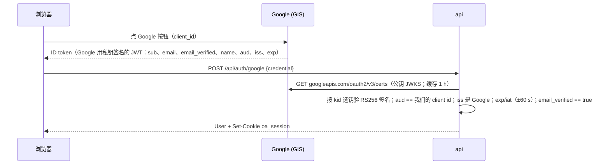

# Proposal: design.md §8.1 登录（L1，供协调者合入 DESIGN / design.md）

### 8.1 登录
三种入口，都换成**我们自己的**会话 cookie `oa_session`（HMAC 签名，httpOnly，SameSite=Lax，`Secure` 按 `COOKIE_SECURE`，7 天）。
之后每个请求只认这个 cookie，不再询问任何第三方。`GET /api/config` 告诉前端哪些入口开着（运行时配置，同一镜像）。

| 入口 | 开关 | 用户键 `(auth_provider, provider_sub)` |
|---|---|---|
| Google | `GOOGLE_CLIENT_ID` 已设 | `("google", sub)`；存 email、name |
| 邀请码 | `INVITE_CODES` 非空（逗号分隔） | `("invite", "<码序号>:<名字 casefold>")` |
| 固定账号 | `DEV_AUTH_USER` 和 `DEV_AUTH_PASSWORD` **都**设 | `("dev", DEV_AUTH_USER)` |

关闭的入口返回 404。

**Google 登录怎么工作**（take-home 非必须项 2）：

- 我们只拿 **ID token**：不需要 client secret，不申请任何 Google API 权限，拿不到用户的 Google 数据，也不保存 token。
- 验签自己做（`PyJWT[crypto]`）：只接受 RS256（拒绝 `none` / HS256 混淆）；未知 `kid` 视为 Google 轮换了密钥，强制重新拉一次
  公钥，但每 60 s 至多一次（防止伪造 kid 让我们狂打 Google）。公钥拉不到 → 503 `auth_unavailable`（不当成密码错误）。
- 同一个 token 在有效期内重复提交仍然通过（无状态验证；它只能再次证明同一个 Google 账号），过期后失败。
- **信任边界**：我们信任 Google 对"这个 sub 属于登录者、邮箱已验证"的断言，仅此而已；前端传来的其他任何东西都不信。
  Google 只在登录那一刻参与；会话由我们签发、由 `SESSION_SECRET` 保护，吊销 = 换 `SESSION_SECRET`。
- Google 只接受 `http://localhost[:port]` 或 https 域名作为 JavaScript 来源；用局域网 IP 访问时只能用固定账号 / 邀请码。
  OAuth 应用需发布为 Production，否则只有测试名单内的账号能登录。

**邀请码**（给评审，不依赖 Google）：内存里只存码的 SHA-256，提交的码与**每个**码做 `compare_digest`（不提前退出）。
名字 NFKC + 合并空白后 1–40 字符、无控制字符（否则 400）。同码同名（不分大小写）= 同一账号；共用一个码又取同名的两人会共用
账号（demo 可接受，已告知）。码的序号进入用户键，所以**改 `INVITE_CODES` 时只能在末尾追加**，否则已有用户会换号。

**登录限速**：`/api/auth/{dev,google,invite}` 合计每客户端 IP 每分钟 10 次（成功也计），超出 429 `rate_limited` + `Retry-After`。
客户端 IP：TCP 对端是可信代理（`TRUSTED_PROXIES`，CIDR 列表，默认 loopback + 私网，即 compose 内的 Caddy）时，取
`CF-Connecting-IP`（Cloudflare 边缘写入，覆盖浏览器发的同名头），否则取 `X-Forwarded-For` 最右侧的非可信地址；对端不可信时
一律用对端地址、忽略这些头。前提：api 端口只在 compose 网络内可达（只有 Caddy 对外）。限速表在内存（api 单 worker），
重启清零，条目数有上限。

**日志**：只记拒绝原因（如 `expired`、`aud`），从不记 token、邀请码、密码；`Settings` 的 repr 不含任何密钥。
